<strong>Backend engineer working on MCP, agent tooling and RAG.</strong>

I fix the small failures that make AI tools unreliable: authentication, pagination, streaming and resource cleanup.

专注 AI 工具与 Agent 基础设施，做能复现、能验证的修复。

  
  

## Selected merged contributions

A few fixes accepted upstream in [MCP Go](https://github.com/mark3labs/mcp-go):

| Problem | Change | Pull request |
| --- | --- | --- |
| Dynamic OAuth registration omitted the application type. | Send `application_type` in the registration request. | [#1003](https://github.com/mark3labs/mcp-go/pull/1003) · merged Oct 22, 2026 |
| Authorization callbacks needed to stay tied to the transaction that started them. | Bind callbacks to their initiating authorization transaction. | [#1006](https://github.com/mark3labs/mcp-go/pull/1006) · merged Oct 22, 2026 |
| Resources with the same name could be missed during pagination. | Handle the cursor tie-break and legacy name-only cursors. | [#991](https://github.com/mark3labs/mcp-go/pull/991) · merged Oct 13, 2026 |
| A recognized modern discovery response could still fall back to the legacy handshake. | Avoid legacy initialization after modern discovery. | [#997](https://github.com/mark3labs/mcp-go/pull/997) · merged Oct 13, 2026 |

[All merged PRs](https://github.com/pulls?q=is%3Apr+author%3Apo-et+is%3Amerged) · [Open PRs](https://github.com/pulls?q=is%3Apr+author%3Apo-et+is%3Aopen)

## Tools I build

| Tool | What it does | Try it |
| --- | --- | --- |
| [HAR Triage](https://github.com/po-et/dsh-har-triage) | Turns a local HAR capture into an offline report of failed and slow requests, linked to the original entry indexes. | [Synthetic demo and CLI](https://github.com/po-et/dsh-har-triage#try-without-harness) |
| [HTTP Probe](https://github.com/po-et/dsh-http-probe) | Gives a Harness agent an HTTP status, header latency and selected response headers without reading the body. Supports cancellation and a GET fallback when HEAD is unsupported. | [Install in Harness](https://github.com/po-et/dsh-http-probe#install--安装) |
| [SheetDiff](https://github.com/po-et/dsh-sheet-diff) | Compares CSV or XLSX files by a business key. Review changed values, types, formulas and stored results in a local HTML report. | [Run the synthetic demo](https://github.com/po-et/dsh-sheet-diff#try-it-locally) |

HAR Triage and SheetDiff also run as standalone CLIs. Their examples use synthetic data and need no model call. SheetDiff compares stored formula results without editing workbooks or recalculating formulas.

## How I contribute

I start with a reproducible failure, keep the fix focused, and add a regression test. I use AI assistance for development and review, with disclosure according to each project's policy.

Most of my code is Go, TypeScript and Python. I am currently focused on MCP clients, agent SDKs and the developer tools around them.

Stack

 

